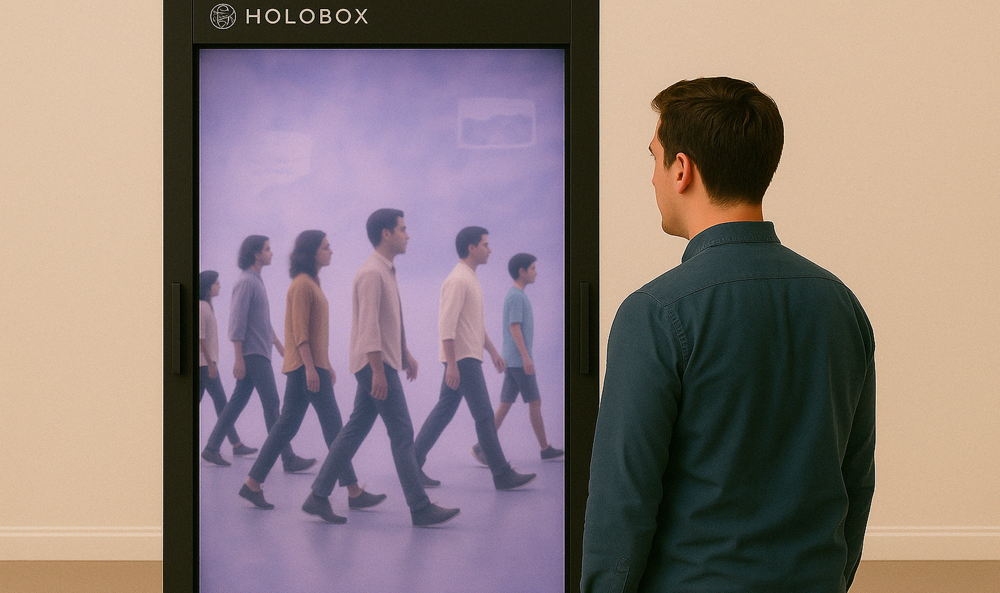

# Op het gezicht geschreven?

Een interactieve experience die laat zien dat de buitenste uitstraling van een persoon niet overeen hoeft te komen met hun echte gevoel. Het is een persoonlijk project voor mijn studie, gemaakt om een project met experience design te proberen.



## Over het project

In het dagelijks leven haasten we ons van plek naar plek, vaak zonder écht stil te staan bij de mensen om ons heen. We nemen gedrag waar, maar zelden de beleving daarachter. Toch schuilt achter elk gezicht een binnenwereld van gedachten en gevoelens, die vaak anders is dan je zou denken.
Met dit project wil ik die onzichtbare gevoelens aan de aandacht brengen. Via een interactieve experience nodig ik bezoekers uit om te vertragen en bewust aandacht te schenken aan iemand die ze niet kennen.

## Wat ik heb gebouwd

- **Integratie met de Holobox** – Het project werkt op de Holobox in Mindlabs en is gebouwd met dit apparaat in gedachten.
- **Experience Design** – Met behulp van eigen content in de vorm van video's en foto's heb ik een Proof of Concept kunnen maken van de ervaring.
- **Interactie** – Het project is interactief en gebruikers kunnen een simpele vorm van de ervaring proberen.

## Technische stack

 - Het gebruikte React Framework

 - CSS integratie gebruikt voor de styling

 - Hosting website gebruikt voor het online zetten van het project

 en **Cursor** - AI assistents gebruikt bij het coderen

**Holobox** – Hardwareplatform voor het simuleren van 3D.

## Wat ik heb geleerd

- Ik heb geleerd hoe je een goede Experience opzet met het 5E-model
- Ik heb voor het eerst gewerkt met externe hardware door gebruik te maken van de Holobox.
- Ik heb geleerd hoe ik video's interactief maak om te zorgen voor realistische visuals die niet bereikbaar zijn met eigen animatie.
- ik heb geoefend Git Workflow en commits

## Projectstructuur

```plaintext
op-het-gezicht-geschreven/
├── app/
│   ├── components/           # Alle herbruikbare componenten (interactieve elementen, overlays)
│   │   ├── InteractiveHotspot.jsx
│   │   ├── SceneTransition.jsx
│   │   ├── SceneTransition.module.css
│   │   ├── ThoughtOverlay.jsx
│   │   └── TimelineHotspot.jsx
│   ├── favicon.ico
│   ├── globals.css
│   ├── layout.jsx
│   └── page.jsx
├── public/
│   ├── backgrounds/          # Achtergrondafbeeldingen
│   ├── data/                 # Data-assets
│   ├── images/               # Overige afbeeldingen
│   ├── main-video.mp4
│   └── readme-cover.png
├── .gitignore
├── README.md
├── jsconfig.json
├── next.config.mjs
├── package-lock.json
├── package.json
└── postcss.config.mjs
```

## Lokaal draaien

De installatie is niet bedoeld voor lokaal gebruik op een computer, maar onderdelen kunnen als prototype worden getest via een lokale webserver:

```bash
git clone https://github.com/jouwnaam/op-het-gezicht-geschreven.git
cd op-het-gezicht-geschreven
npm install
npm run dev
```

Open daarna [http://localhost:3000](http://localhost:3000) in je browser. Let hierbij wel op dat het beeld 90-graden gedraaid is. Dit is voor het beeld op de holobox en dus normaal op een computerscherm.

## Toekomstplannen

Met meer tijd zou ik werken aan;

- Het oplossen van bugs in het huidige proof of concept
- Het verwerken van feedback uit gebruikerstesten
- Het uitbreiden van content door het toevoegen van meer personages. Hierbij zou ook onderzoek moeten komen naar welke situaties via mijn project gedeeld kunnen worden.

## Deployment

De site is automatisch gedeployed via Vercel. Het beeld is in deze versie 90 graden gedraaid omdat dit nodig is voor recht beeld op de Holobox. Verder zijn alle functionaliteiten wel beschikbaar, maar mogelijk zijn er problemen met de grootte van je computerscherm.

---

**Gebouwd door:** Niels de Laat  
**Live versie:** [Bekijk de website](https://op-het-gezicht-geschreven.vercel.app/)

_Dit project is onderdeel van mijn studie en een eerste kennismaking met experience design._
